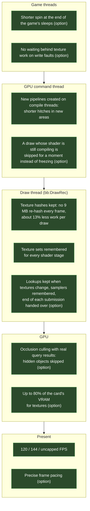
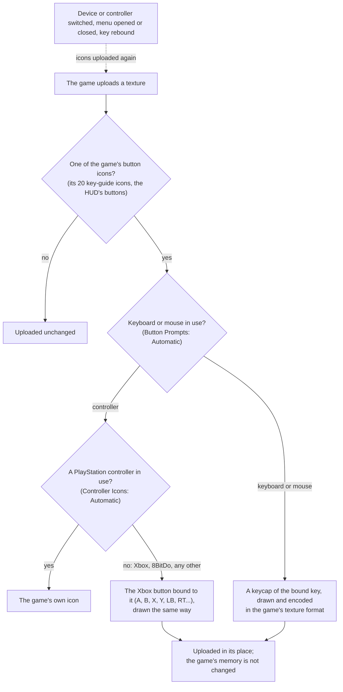
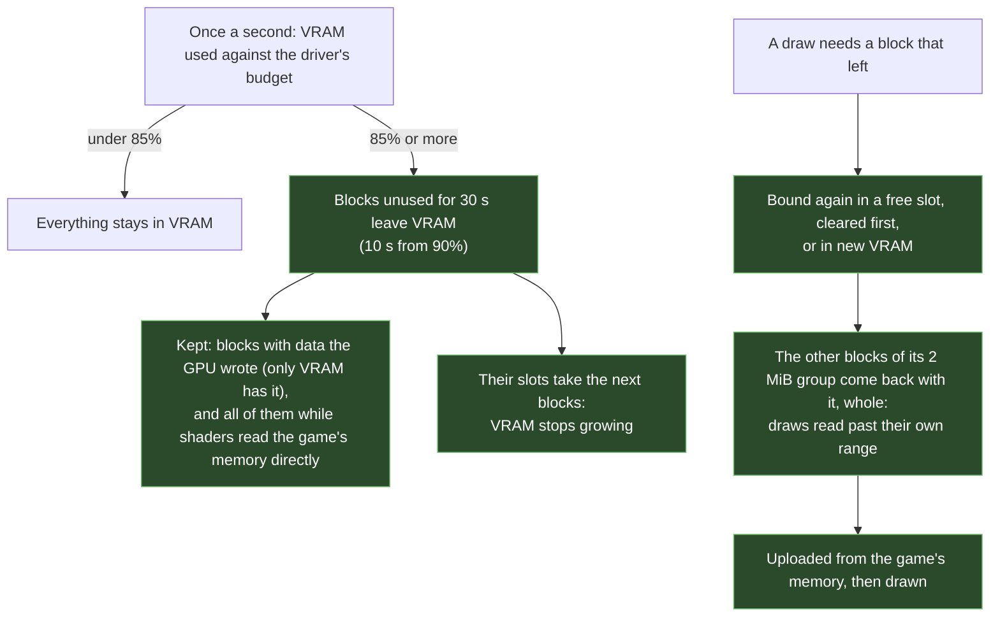
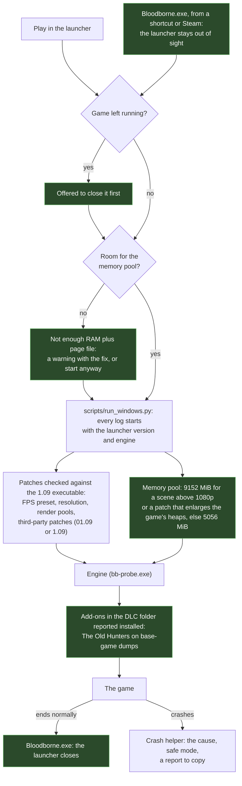

# Bloodborne PC

Bloodborne on Windows in one package: my launcher and my own engine. You only need your own game dump.

**Community:** [join the Discord](https://discord.gg/d3Uv3Cfr5x) for help, news, co-op partners and beta feedback.

**No game files are included.** Bring a decrypted Bloodborne dump (CUSA03173 or another
region) with update 1.09.

## Install

1. Download `BloodbornePC-<version>-win64.zip` from
   [Releases](https://github.com/Awakenchan/BloodBorneButPc/releases) and extract it anywhere.
2. Run `Bloodborne Launcher.exe` and choose your game folder (the one with `eboot.bin`).
3. Press **Play**.

The launcher updates itself from the Releases page.

## Features

- **Play**: game folder check, player profiles (each with its own saves and trophies), automatic save backups with restore, save import from shadPS4 or another port, DLC folder (The Old Hunters on base-game dumps), session summary. `Bloodborne.exe` starts the game straight away with your settings (for a shortcut or Steam).
- **Display**: resolution (or your display's own, any shape), monitor selection, fullscreen, widescreen (21:9, 32:9), native HDR, 30 to 144 FPS or uncapped, in-game menu in 9 languages.
- **Graphics**: FSR 4, FSR 3, DLSS and DLAA, TAA, sharpening, occlusion culling, picture and camera tuning, FPS counter (frame rate, frame time, upscaler), best settings for your PC.
- **Controls**: keyboard and mouse for every action, the game's button prompts shown as your keys or as Xbox buttons, controller remapping, stick options, live controller detection, shareable profiles.
- **Cheats**: Blood Vials and Quicksilver Bullets (infinite or a set amount), infinite consumables and stamina, stealth, no weapon wear, firearm range, keep echoes on death, echo multiplier. Each can be turned off.
- **Trophies**: all 40, completion rate, in-game notification, reset.
- **More**: mods and patches, online on The Hunter's Dream (messages, bloodstains, co-op and invasions with bbhost players, through bbhost's own network code; an account with Discord or without it, with a recovery code), game log, crash helper with safe mode, memory check before starting, stable or beta updates with a version selector.

### Control profile format

```json
{
  "format": "bbport-controls",
  "version": 2,
  "name": "Mouse focus",
  "author": "you",
  "description": "Attacks on the mouse",
  "bindings": { "attack": "Mouse1", "strong_attack": "Mouse3", "lock_on": "Mouse2", "roll": "Space" }
}
```

Actions: `move_forward move_back move_left move_right walk roll l3 attack strong_attack
strong_modifier transform firearm lock_on blood_vial use_item interact switch_item switch_right
switch_left dpad_up gestures personal_effects menu confirm back look_up look_down look_left
look_right`. Keys use SDL names (`Space`, `Left Shift`, `Return`, `F`); mouse inputs are
`Mouse1` (left), `Mouse2` (middle), `Mouse3` (right), `Mouse4`, `Mouse5`, `WheelUp`, `WheelDown`. Each action takes one key and one mouse input.

## Building the launcher

.NET 8 SDK on Windows:

```
dotnet build launcher/windows/BloodborneLauncher.sln -c Release
```

`launcher/windows/LauncherBuilder` builds `Build Launcher.exe`, which rebuilds the launcher when
its sources change (`--force` always). Put a folder path in `launcher/windows/install.txt` to
install into a package folder instead of `LauncherApp/`.

## Engine

The engine is developed here. It started from [DarkIzuku/bloodborne_pc](https://github.com/DarkIzuku/bloodborne_pc)
(built on bbport and shadPS4) and has been reworked for Windows since: about 19,000 lines changed or added
across nearly 150 files.

- **Performance**: occlusion culling with real query results, cached texture, sampler and render target lookups,
  the end of each frame handed to the draw thread, render threads first, uncapped FPS. Up to the 120 FPS cap in
  busy areas on a Ryzen 5 5600 with an RTX 5060. Some of these are switches under Graphics › Experimental.
- **Picture**: native HDR (highlights from the game's own HDR scene), DLSS texture LOD bias, FSR 4 balanced model.
- **Stability**: fixes for silent crashes (0xC0000005), exit 23 asserts, low memory and display loss; crash
  reports and dumps; a GPU hang guard; VRAM cleanup, and game data leaving VRAM on cards that run short (4 GB).
- **Sound**: the game's audio threads at their PS4 priority on Windows.
- **Game**: cheats, menu languages, controller support, online with The Hunter's Dream, The Old Hunters on
  base-game dumps (DLC folder), 120 and 144 FPS from the 90 FPS patch.

The patch against the starting point, every change with its switch, and build steps are in [engine/](engine/).

### What I changed

The starting point already ran the game's own code natively and split GPU work over several
threads. The charts show what was changed here on top of it; each item is a row in
[engine/](engine/) with its switch. **(option)** means off by default, with a switch in the launcher.

#### Performance: where each change acts



#### Stability: what used to go wrong, and what happens now

```mermaid
flowchart LR
    s1["Write fault at the end of a GPU mapping:<br/>crash 0xC0000005"] --> f1["Handled, the game goes on"]
    s2["Engine fault on a game thread:<br/>Windows closed the game without a trace"] --> f2["Crash report with the thread and call chain,<br/>crash.dmp next to the log"]
    s3["Unknown texture format or lost display:<br/>exit 23"] --> f3["A known format is used,<br/>the display is recreated"]
    s4["Textures freed while still in use:<br/>stalls, GPU device lost"] --> f4["Hang guard: textures in use are never freed,<br/>deleted ones kept a little longer"]
    s5["VRAM fills up over a long session"] --> f5["VRAM cleanup: GPU-drawn textures written back<br/>and freed under memory pressure"]
    s6["Patch made for another executable:<br/>writes into the wrong code, crash at start"] --> f6["Checked against the 1.09 executable,<br/>left out and logged"]
    s7["Resolution patch above 1080p:<br/>game memory pool full, crash"] --> f7["Larger pool given;<br/>a full pool is explained in the crash report"]
    s8["Sound slowly falls behind the picture"] --> f8["Output follows the device's real rate"]
    s9["Online: signed out by the server,<br/>a network drop sent the game to the title menu"] --> f9["Client reports its version,<br/>90 s to reconnect"]
    s10["Unlock Game Region with online on:<br/>no server for that region"] --> f10["Left out while online, unless you keep it"]
    s11["Busy frame (a boss intro at high model detail):<br/>a render pool ran out, crash"] --> f11["Render pools four times larger"]
    s12["120 / 144 FPS: the game froze<br/>at the end of Vicar Amelia's intro"] --> f12["The 90 FPS patch,<br/>with its values for that rate"]
    s13["4 GB cards: game data piled up in VRAM,<br/>exit 23 or a lost device"] --> f13["Above 85% of the VRAM budget, data unused<br/>for 30 s leaves VRAM (chart below)"]
    s14["1440p or 4K output: 10 GB asked at start,<br/>Windows error 1450, crash at launch"] --> f14["10 GB only for a scene above 1080p; the launcher<br/>warns first and closes a game left running"]
    s15["120 / 144 FPS: the character<br/>fell 1.5 to 1.8 times as fast"] --> f15["Its frame time scaled<br/>like the patch's other values"]
    s16["Keyboard: W right after closing a menu<br/>was a held d-pad up (HP into bullets)"] --> f16["Keys act as the d-pad only<br/>while a menu has the screen"]
    classDef was fill:#4a2b2b,stroke:#bf6f6f,color:#fff
    classDef now fill:#2b4a2b,stroke:#6fbf6f,color:#fff
    class s1,s2,s3,s4,s5,s6,s7,s8,s9,s10,s11,s12,s13,s14,s15,s16 was
    class f1,f2,f3,f4,f5,f6,f7,f8,f9,f10,f11,f12,f13,f14,f15,f16 now
```



#### Button prompts: keyboard, mouse and Xbox



#### Game data in VRAM: why 4 GB cards no longer run out

Every block of the game's memory a draw uses gets a copy in VRAM. Before, those copies stayed for good,
so VRAM only grew with every area visited.



#### Starting the game



## Credits

| | |
|---|---|
| Engine starting point | [DarkIzuku/bloodborne_pc](https://github.com/DarkIzuku/bloodborne_pc) (built on [bbport](https://github.com/deadinside28/bloodborne_pc) and [shadPS4](https://github.com/shadps4-emu/shadPS4)) |
| VRAM cleanup | adapted from [IFreemz/shadPS4-Bloodborne-DLSS-FSR](https://github.com/IFreemz/shadPS4-Bloodborne-DLSS-FSR) |
| Crash and controller fixes | adapted from [AwesomeObserver](https://github.com/AwesomeObserver/bloodborne_pc), [Supermedo](https://github.com/Supermedo/bloodborne_pc) and [deadinside28](https://github.com/deadinside28/bloodborne_pc) |
| Cheats and occlusion culling research | [droogie/bbhost](https://github.com/droogie/bbhost) |
| Controller mappings | [SDL_GameControllerDB](https://github.com/mdqinc/SDL_GameControllerDB) |
| Trophy list | [pyL1nx/bloodborne_pc](https://github.com/pyL1nx/bloodborne_pc) |
| UI library | [WPF-UI](https://github.com/lepoco/wpfui) |

## License

The launcher is GPL-2.0-or-later (see [LICENSE](LICENSE)). The engine is GPL-3.0-or-later; its licenses are in the package's `licenses/` folder.
